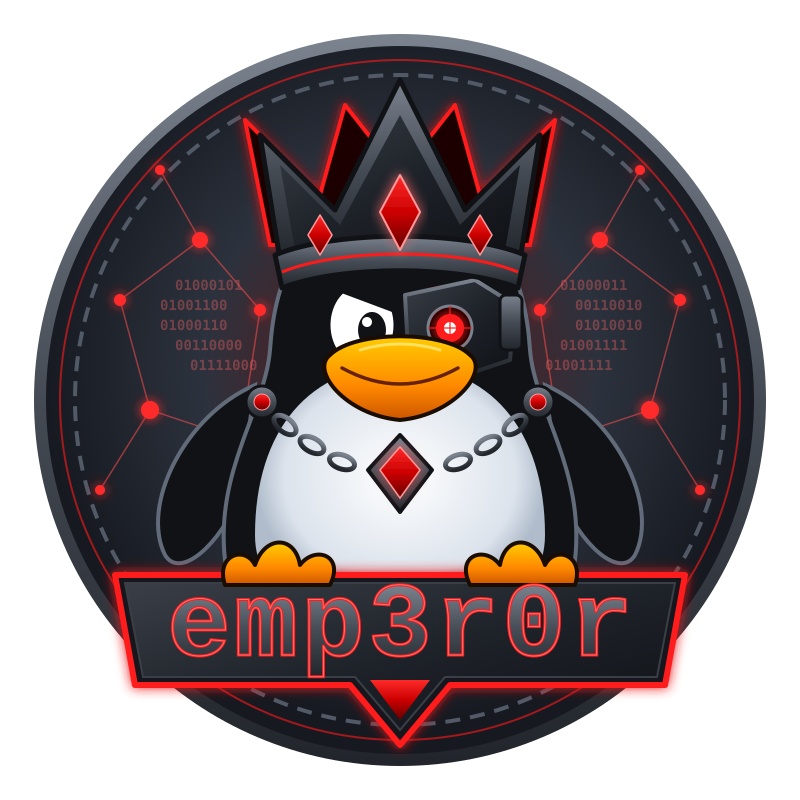

### emp3r0r



Linux-first multi-operator C2 built to stay quiet and keep working. Self-healing mesh with assisted discovery, in-memory execution with encrypted storage, scriptable agents, cross-platform BOFs, SOCKS5 pivoting, and a modular C agent delivered by a sleep-masking stager.

<br clear="all" />

[](https://discord.gg/vU98aQtk9f)
[](https://github.com/sponsors/jm33-m0)


[](https://github.com/jm33-m0/emp3r0r/actions/workflows/test.yml)

[](https://github.com/jm33-m0/emp3r0r/releases)


## What is emp3r0r?

emp3r0r started as a Linux post-exploitation framework with interactive remote shells and autonomous network pivoting. Over time it grew into a multi-operator C2 with modular agents, a P2P mesh, and in-memory execution on both Linux and Windows.

## Features

### Extensibility

#### Scriptable agents

Every agent has an embedded Starlark engine. A module can add post-exploitation logic without rebuilding the agent or uploading an interpreter. Scripts run inside the agent process and use built-in APIs for file I/O, HTTP, process execution, and other common work. They can also call Win32 functions and Linux syscalls through the agent's API proxy. When a script needs an API that is not already present, it can load a DLL or SO from encrypted memfs or the C2 with [`mem_load_library`](#in-memory-library-loader), call its exports, and unload it when done. [Linux eBPF modules](#linux-modules-and-ebpf) use the same path to load `libbpf`.

Modules are a Starlark file and a small JSON manifest. The agent loads them in memory and does not spawn Python, Bash, PowerShell, or another command interpreter. [Compiled modules](#compiled-modules) use the same in-memory delivery path but run native code.

#### Compiled modules

BOF, ELF, and PICO modules run in the agent process on both platforms:

- Windows COFF/BOF objects with typed argument packing.
- Linux ELF relocatable objects loaded from memory by the [in-memory loader](#in-memory-library-loader).
- Crystal-Kit PICO modules with SilentMoonwalk call stack spoofing.

The repository ships Kerbeus-BOF, Remote-OPs, and a Situational Awareness suite. Running a BOF does not start another process or write the object to disk. On Windows, modules can run under a borrowed [access token](#windows-tokens-and-kerberos).

#### Linux modules and eBPF

Linux modules are Starlark scripts with access to the kernel through libbpf. The agent maps `libbpf` when a module needs it and exposes its API as Go-backed builtins. This uses the same on-demand loader that [`mem_load_library`](#in-memory-library-loader) exposes; libbpf is just another shared object the module asks for. A script can enumerate BPF objects, attach programs, manage maps and links, and start or stop uprobes.

[`ssh_harvest`](./core/modules/ssh_harvest/) is the worked example. It finds a pattern in `sshd`, attaches a long-lived uprobe, streams captured credentials, and keeps the probe running until `--disable`. It uses no ptrace, breakpoints, or temporary files.

The loader can map any `.so` a module declares or supplies, including raw bytes provided by the script.

### In-memory operation

#### In-memory library loader

`memmod` maps shared libraries into the agent's address space and calls their exports in place. On Windows it loads PE DLLs. On Linux it loads ELF `.so` files and applies relocations, imports, and symbol lookups without `LoadLibrary` or `dlopen`.

The PE side follows WireGuard's `memmod`. The ELF side follows [Sliver](https://github.com/BishopFox/sliver) and [sliverarmory/reflektor](https://github.com/sliverarmory/reflektor). `memdeps` sits on top: a module declares a dependency, the agent gets it from [encrypted memory storage](#encrypted-memory-storage) or the C2, maps it for one operation, then unmaps it.

[Starlark modules](#scriptable-agents) can use the same loader directly with `mem_load_library`. They are not limited to APIs that are already loaded in the agent or target process.

#### Encrypted memory storage

Agent file operations use an in-memory AES-GCM encrypted filesystem. Large files spill to disk only as encrypted blobs with no identifying headers. Agents that take part in the [P2P mesh](#p2p-mesh) cache files in this filesystem and share them with peers.

### C2 communication

#### Agent identity

The first successful check-in pins the agent's public key and signed UUID. Later check-ins must use the same identity. A different key or signature is rejected instead of quietly replacing the old agent. Removing an agent is an operator decision.

C2 and peer connections use ephemeral ECDH keys for each session. A compromised long-term key cannot decrypt traffic from earlier sessions.

#### Listeners and transport

The C2 supports HTTP, TCP, and UDP listeners. Agents can use beacon-style HTTP polling, streaming HTTP/2, or a QUIC UDP channel. HTTP/2 and QUIC are build-time options (`with_h2conn`, `with_quic`). QUIC obfuscates datagrams with a per-build key by default. The `--quic-standard-key` flag disables that and speaks stock QUIC.

HTTP polling uses a malleable request profile from the C2 config. TLS fingerprints can be randomized with uTLS. Behind an ECH-capable CDN, `--doh` and `--ech` hide the inner SNI from the ClientHello. Control messages use CBOR rather than JSON.

### Delivery

#### Stager and sleep masking

The [Linux stager](./core/modules/stager_linux/) talks to the kernel through direct syscalls, needs no libc on the target, and keeps transports and packers pluggable: HTTP, TCP, UDP, libcurl, or libssl for delivery, and RC4 or LZSS for packing. It can fetch the [C agent](#c-agent) at runtime or embed its PIC with `--agent-pic`, leaving the downloader and listener configuration out of the artifact.

The agent's sleep mask lives in the stager. While it sleeps, the stager flips the agent's executable pages to non-executable and encrypts the agent images, heap, and stack. No anonymous executable mapping is left behind, and executable mappings return only when the agent wakes and runs. Everything the mask covers is encrypted, and the [provider](./core/modules/stager_linux/mask.h) is pluggable, so a custom implementation can replace the default XOR scheme.

#### C agent

The [C agent](./core/c_agent/) is deliberately thin: a C2 beacon with no built-in features. It implements only file I/O, network I/O, and `dynload` helpers that resolve code already present on the host. Everything else arrives as [BOF modules](#compiled-modules), and even the BOF loader is a dependency module mapped from memory at run time instead of being linked in.

Operators generate it with `generate_c`:

```bash
generate_c --type glibc --arch amd64 --cc your.domain.com
generate_c --type glibc --arch amd64 --cc your.domain.com \
  --interval 60 --jitter 50 --poll-window 5 --offline-grace 0
```

### Network movement

#### P2P mesh

Agents can discover each other and relay traffic through a gossip mesh. Peer links use camouflage mTLS 1.3, Windows SMB named pipes, or KCP over UDP, and every hop is encrypted. If a relay dies or the C2 becomes unreachable, traffic can move through another peer.

Files can also move directly between peers. The agent keeps fetched files in [encrypted memory storage](#encrypted-memory-storage) and serves them to peers on request. If no peer has a file, the agent fetches it from the C2.

#### Pivoting

The C2 can run a SOCKS5 listener that relays through an agent. The operator can use it from inside the WireGuard tunnel or start `tun2socks` with a route. For example:

```text
socks_start 1080
tun2socks start --route 10.10.0.0/24
```

Only the listed subnet goes through the agent. Everything else keeps using the operator's normal connection. Tools that do not support a proxy can still reach the agent-side network.

### Credentials

#### Windows tokens and Kerberos

On Windows, emp3r0r can use an access token from another process for Go modules, [Starlark](#scriptable-agents), and [BOFs](#compiled-modules). Modules accept `--token` for an existing token, `--user` for a disposable netonly session, and `--ticket` for a Kerberos ticket.

A netonly session keeps the agent's local identity and borrows the target user only for outbound authentication. A ticket can be imported into the same session, so the network identity becomes the ticket's identity while the local process stays unchanged. Because the session is disposable, the credential material can be purged when the operation is done.

### Build profiles

#### Modular agent builds

Agent features are selected at build time with `with_*` tags, including the [agent transport](#listeners-and-transport). The installer builds a slim kit by default: Linux and Windows amd64 agents with plain HTTP polling and no optional subsystems. `--full` builds every target and every feature. `--agent-tags` selects an exact feature set, and `--list-agent-tags` prints the available tags.

C2 server binaries keep the full feature set, so one server can handle every agent variant.

## Documentation

- [Operator guide](./OPERATOR.md): installation, quick start, operator setup, container notes, tmux keybindings, and agent generation.
- [Module development guide](./core/modules/module_development_guide.md)
- [Testing guide](./TESTING.md)
- [Security policy](./SECURITY.md)
- [Changelog](./CHANGELOG.md)

## Support

If emp3r0r is useful in your security research or testing, you can support development through [GitHub Sponsors](https://github.com/sponsors/jm33-m0).
